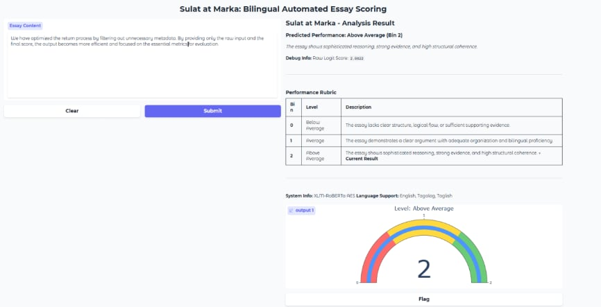
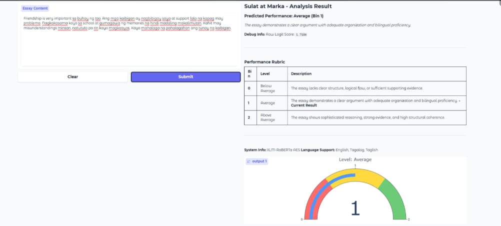
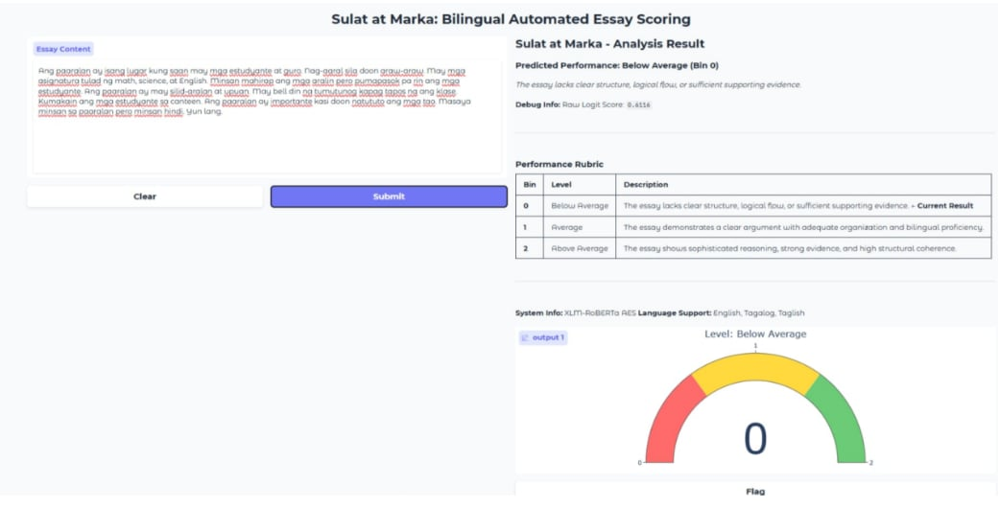

# Sulat at Marka: Bilingual Automated Essay Scoring

[](https://colab.research.google.com/github/GeloLazo/Sulat-at-Marka-nlp/blob/main/sulat_at_marka.ipynb)

**Sulat at Marka** ("Write and Mark") is an automated essay scoring (AES) system built on a fine-tuned **XLM-RoBERTa** model. It places an argumentative essay into one of three performance levels (Below Average, Average, Above Average) and shows the result in a Gradio web interface with a score gauge and a rubric.

The project explores whether a multilingual transformer can support essay scoring for Philippine classrooms, where essays are often written in English, Tagalog, or Taglish (code-switched text).

## Overview

| | |
|---|---|
| **Task** | Score argumentative essays into 3 levels (Bin 0, 1, 2) |
| **Model** | `xlm-roberta-base` fine-tuned for regression (`num_labels=1`, MSE loss) |
| **Training data** | ASAP 2.0 dataset, 17,307 essays scored 1 to 6 |
| **Interface** | Gradio app with gauge chart and rubric table |
| **Environment** | Google Colab (GPU), Python |
| **Stack** | PyTorch, Hugging Face Transformers, scikit-learn, imbalanced-learn, Plotly, Seaborn, Gradio |

## Gradio Web Interface & Test Cases

Sample essays in three languages, scored by the deployed model. Each screenshot shows the predicted level, the raw score, the rubric, and the gauge.

<div align="center">

### English Evaluation (Bin 2 - Above Average)


### Taglish Evaluation (Bin 1 - Average)


### Tagalog Evaluation (Bin 0 - Below Average)


</div>

## How It Works

1. **Data cleaning:** URLs are replaced with a `[URL]` token, punctuation is stripped, and very short entries are dropped.
2. **Label binning:** the original 1 to 6 scores are grouped into three levels: scores 1-2 become Bin 0 (Below Average), 3-4 become Bin 1 (Average), and 5-6 become Bin 2 (Above Average).
3. **Split:** stratified 70/15/15 into 12,114 training, 2,596 validation, and 2,597 test essays.
4. **Balancing:** `RandomOverSampler` duplicates minority classes in the training set only (12,114 to 21,432 essays, 7,144 per bin).
5. **Fine-tuning:** `xlm-roberta-base`, 5 epochs, learning rate 2e-5, batch size 8, max length 256, weight decay 0.01, 500 warmup steps, early stopping (patience 2), best checkpoint chosen by Quadratic Weighted Kappa. Training took about 46 minutes on a Colab GPU.
6. **Inference:** the model outputs a continuous score. Manual thresholds convert it to a bin: below 1.10 is Bin 0, below 1.90 is Bin 1, otherwise Bin 2.
7. **Interface:** a Gradio app shows the predicted level, the raw score, a gauge chart, and the rubric description.

## Results

Evaluated on the held-out test set of 2,597 essays.

| Metric | Value |
|---|---|
| Quadratic Weighted Kappa (QWK) | 0.5653 |
| Pearson correlation (continuous output) | 0.5829 |
| Mean squared error (continuous output) | 0.2932 |
| Exact match accuracy (3 bins) | 70.93% |
| Adjacent accuracy (within one bin) | 99.65% |

**Comparison with a traditional baseline (TF-IDF + SVR):**

| Metric | TF-IDF + SVR | XLM-RoBERTa |
|---|:---:|:---:|
| QWK | 0.5971 | 0.5653 |
| MSE | 0.1716 | 0.2932 |
| Pearson | 0.6955 | 0.5829 |

**Per-class performance:**

| Level | Precision | Recall | F1 | Essays |
|---|:---:|:---:|:---:|:---:|
| Below Average (0) | 0.78 | 0.64 | 0.70 | 897 |
| Average (1) | 0.75 | 0.78 | 0.76 | 1,531 |
| Above Average (2) | 0.29 | 0.44 | 0.35 | 169 |

## Limitations

These results are reported as they came out of the notebook:

* **The baseline performed better.** The TF-IDF + SVR baseline scored higher than XLM-RoBERTa on QWK, MSE, and Pearson. Essay length is strongly correlated with score in this dataset, which favors keyword and length-based features.
* **Adjacent accuracy is generous with three bins.** Only Bin 0 versus Bin 2 confusions count as errors, so 99.65% is easy to reach. Exact accuracy (70.93%) and QWK (0.5653, moderate agreement) are the more informative numbers.
* **The Above Average class is weak.** It is only 6.5% of the data, and precision for that class is 0.29.
* **Tagalog and Taglish were not evaluated on labeled data.** The model was fine-tuned on ASAP 2.0, which is English. Tagalog and Taglish support relies on XLM-RoBERTa's cross-lingual transfer, and was only checked with a few sample essays in the notebook, not with a labeled Tagalog or Taglish test set.
* **Inference thresholds (1.10 and 1.90) were set manually** to reduce the model's conservative bias toward the middle bin.

The system is best seen as a research prototype for a human-in-the-loop grading setup rather than a replacement for teacher grading.

## Repository Contents

```
.
├── sulat_at_marka.ipynb        # Full pipeline: data, training, evaluation, Gradio app
├── Assets-Sulat-At-Marka/      # Screenshots used in this README
└── README.md
```

## Run It Yourself

1. Open the notebook in Google Colab using the badge above and choose a GPU runtime.
2. Get the ASAP 2.0 dataset from Kaggle and save it as `train.xlsx` in your Google Drive at `MyDrive/Sulat/train.xlsx` (columns: `essay_id`, `full_text`, `score`).
3. Run the cells in order. Training saves the model to `./sulat_at_marka_model`.
4. Copy that folder to your Google Drive as `MyDrive/SulatAtMarka_Model`. The inference and Gradio cells load the model from there.

## Not Included

* **The dataset.** ASAP 2.0 is obtained from Kaggle and is not redistributed here.
* **The fine-tuned model weights.** They are over 1 GB, which is too large for a regular GitHub repository.

## Author

**Evan Gelo T. Lazo**: IT Graduate, José Rizal University (2026)
[github.com/GeloLazo](https://github.com/GeloLazo)
